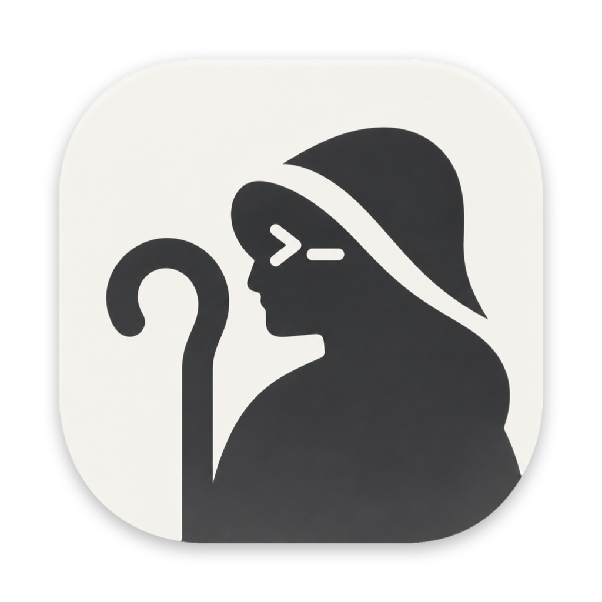

<p align="center">
  
</p>

<h1 align="center">Pastora</h1>

<p align="center">
  A personal fork of <a href="https://github.com/herdrdev/herdr-app">Herdr</a> <b>0.1.18</b>
  (<a href="https://github.com/herdrdev/herdr-app/commit/a2e8e3ffa84439d4a245a1e6aa8947ef0dd20a1b"><code>a2e8e3f</code></a>)
  · <a href="https://github.com/herdrdev/herdr-app/blob/a2e8e3ffa84439d4a245a1e6aa8947ef0dd20a1b/README.md">Herdr's README</a>
</p>

## What it adds

- **Its own name, icon and home.** `HERDR_APP_NAME`, `HERDR_APP_ICON` and `HERDR_APP_DIR_NAME` at build time; mods read the name with `appName()`. Installs beside Herdr without touching it.
- **Markdown styling for `TextView`.** `inline_code_color`, `inline_code_background`, `link_color` and `md_style(part, s => …)` for headings, code, tables, quotes, lists, rules, bold and italic.
- **Live reload through symlinks.** A home that links another one's files (`~/.config/pastora` → `~/.config/herdr-app`) sees their edits at once.

## Install

macOS, Rust 1.95 and Zig 0.16:

```sh
git clone --recurse-submodules git@github.com:ArturAlcoverro/pastora.git
cd pastora && scripts/install-pastora
```
